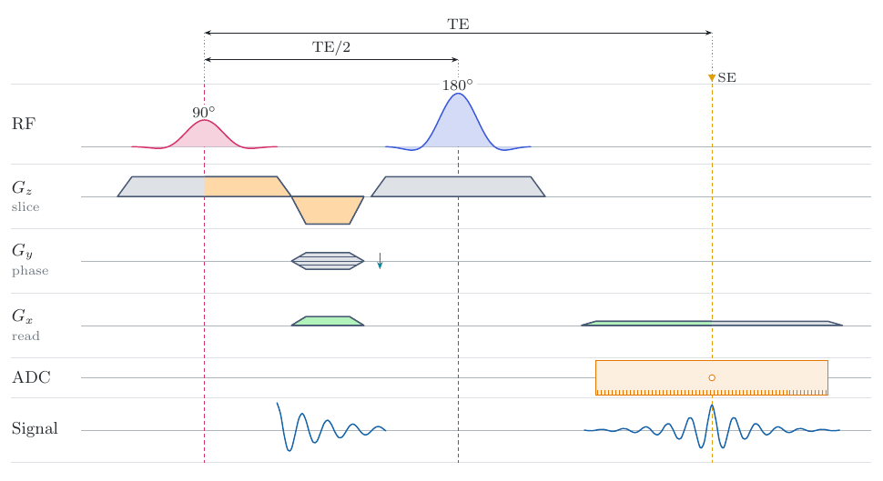
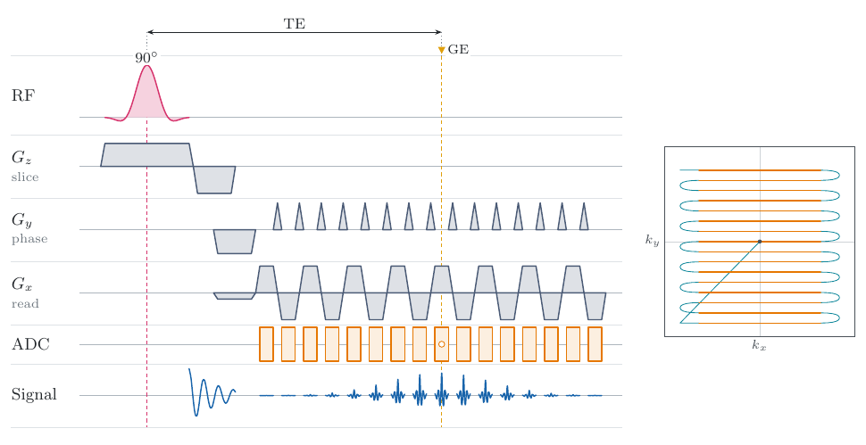
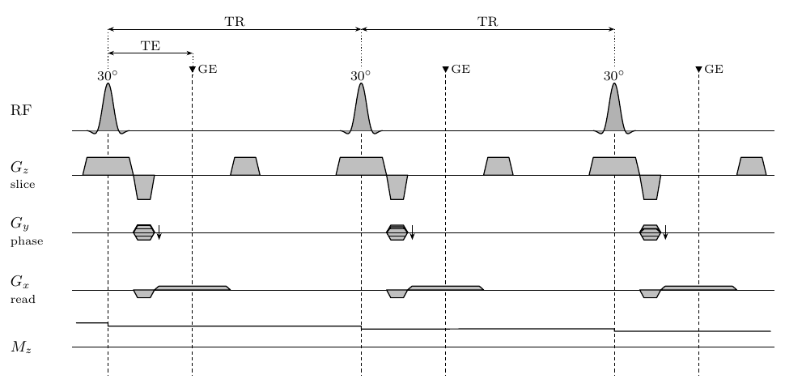
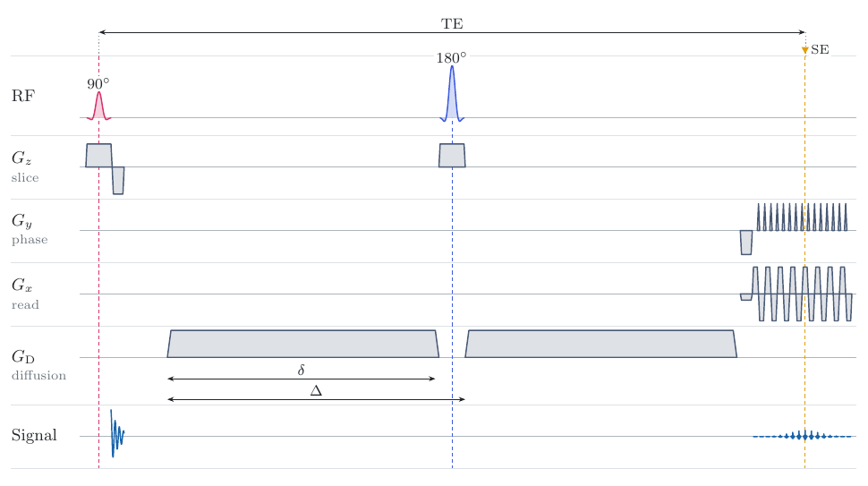
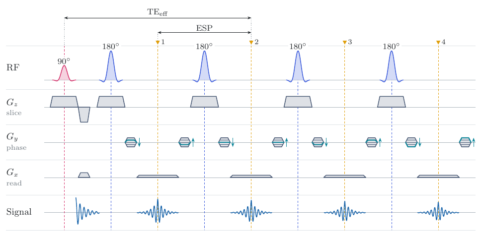

# mriseq — MRI pulse sequence diagrams for LaTeX

`mriseq` draws MRI pulse sequence diagrams as vector graphics with TikZ,
directly in your LaTeX document. The diagrams are physically consistent:
timings and gradient amplitudes are computed from imaging parameters.
The visual style is based on
[mriSimGraphical](https://github.com/filip-szczepankiewicz/mriSimGraphical)
by Filip Sz (Lund University).



## Features

* **Ready-made sequences**: spin echo, gradient echo, inversion recovery,
  EPI (gradient or spin echo, single or multi-shot), turbo spin echo, and
  diffusion-weighted spin echo and SE-EPI. They are computed from TE, TR, TI,
  slice thickness, FOV, matrix, dwell time, b-value and so on, e.g.
  9.39 mT/m slice selection for a 5 mm slice and a 2 ms sinc pulse.
* **Building blocks** for anything else: RF pulses (sinc, Gauss, hard, sech),
  trapezoid gradients (by amplitude, duration or area), phase-encoding tables,
  ADC windows, FID and echo signals, free waveforms, markers and timing
  intervals, plus arbitrary TikZ code in sequence coordinates.
* **Show only what you need**: choose the rows (`rows={rf,gx}`), a time window
  (`time=0:4.5`), the timings to mark (`annotate={TE,TR}`), and whether numbers
  and a time axis are printed (`schematic` / `detailed`).
* **Long sequences**: empty stretches (TI, TR) are cut automatically with axis
  cut marks (`//` or zigzag); `repetitions=3` draws three full TRs and steps
  the phase encoding.
* **k-space**: k(t) rows and a k-space trajectory panel computed exactly from
  the gradients (`kspace=right`).
* **Teaching aids**: shade equal gradient areas (`equal areas`,
  `\shadearea`), the longitudinal magnetisation `M_z`, signal amplitudes from
  T1, T2, T2* and b·D.
* **Clean labels**: numbers never overlap each other or other waveforms; numbers
  that do not fit are left out.
* **Styles**: `color` (default), `bw` (black lines and text, gray fills),
  `grayscale`, or your own with `\mriseqdefinestyle`. Narrow diagrams (e.g. in
  subfigures) switch to a compact layout automatically.

| | |
|---|---|
|  |  |
|  |  |

## Usage

```latex
\usepackage{mriseq}        % or \usepackage[bw]{mriseq}

\begin{figure}
  \centering
  \SpinEchoDiagram[TE=10]
  \caption{Spin-echo sequence.}
\end{figure}

\SpinEchoDiagram[detailed]                       % numbers and time axis
\GradientEchoDiagram[flip label=$\alpha$, equal areas]
\InversionRecoveryDiagram[rows={rf,gz,gy,gx,sig,mz}, TI=300]
\EPIDiagram[kspace]
\EPIDiagram[shots=4, repetitions=4, kspace]
\TurboSpinEchoDiagram[ETL=6]
\DiffusionSpinEchoDiagram[b=1000]
\SpinEchoDiagram[repetitions=3, TR=600]
\SpinEchoDiagram[rows={rf,gz}, time=0:4.5]       % only the slice selection

\begin{mriseq}[rows={rf,gx,adc}, ticks]          % your own diagram
  \rfpulse{center=1, dur=1, flip=90}
  \gradient{gx}{start=1.7, flat=0.8, amp=-1}
  \gradient{gx}{center=5, flat=3.2, amp=0.5}
  \readout{center=5, samples=32, dwell=0.1}
  \interval{1}{5}{TE}
\end{mriseq}
```

The manual, [`doc/mriseq-doc.pdf`](doc/mriseq-doc.pdf), has every option
with examples, and lists the formulas used for the numbers.
[`examples/lab-report-figures.tex`](examples/lab-report-figures.tex) has
ready-to-use figures for a report.

## Requirements

A LaTeX kernel from 2022-06 or later (TeX Live 2022+, current MiKTeX, Overleaf)
and TikZ. Works with pdfLaTeX, XeLaTeX and LuaLaTeX.

## Installation

Download `mriseq.sty` (in `tex/`, or the zip of a
[release](https://github.com/Glindeb/mriseq/releases)) and either

* put it next to your `.tex` file (on Overleaf: upload it to the project), or
* copy it to your personal texmf tree, e.g. `~/texmf/tex/latex/mriseq/`
  (Linux), `~/Library/texmf/tex/latex/mriseq/` (macOS); on MiKTeX add a
  user root directory in the MiKTeX console.

## Compile time

Each diagram is computed by TeX, roughly 0.5–3 s per diagram. With TikZ
externalisation (`\usetikzlibrary{external}\tikzexternalize`, needs
`-shell-escape`) unchanged diagrams are cached and cost almost nothing.

## Building

`./build.sh` builds the manual and the example file; `./build.sh release`
also builds the release zip in `build/`.

## Notice on the use of generative AI

This package, its documentation and its examples were developed with
substantial assistance from a generative AI tool (Claude Code, by Anthropic),
under the direction of the author. The author is responsible for the content.
Please check the diagrams you use, and report errors or physically wrong
results in the [issue tracker](https://github.com/Glindeb/mriseq/issues).

## Author and licence

Gabriel Lindeblad ([@Glindeb](https://github.com/Glindeb)).

Released under the [LaTeX Project Public License](https://www.latex-project.org/lppl.txt),
version 1.3c or later (see `LICENSE`).
